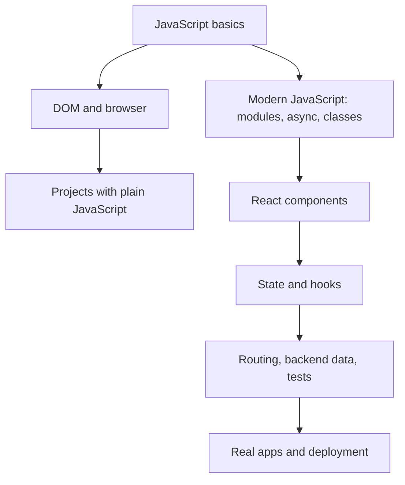

# Complete JavaScript and ReactJS Notes

These notes are written as a beginner-to-advanced path. Read them in order if you are learning from zero. Use the topic files as a reference when you are building projects.

## How To Study

1. Read one chapter.
2. Type every code example yourself.
3. Change the example and predict the output.
4. Build the mini task at the end of the chapter.
5. Return later and reread the same topic after building projects.

Programming becomes clear through repetition. Do not try to memorize every method name at once. First understand the idea, then practice.

## Files

- [01-javascript-foundations.md](./01-javascript-foundations.md): JavaScript from zero, values, variables, functions, arrays, objects, DOM basics.
- [02-javascript-advanced.md](./02-javascript-advanced.md): Scope, closures, prototypes, classes, async JavaScript, modules, errors, testing, TypeScript overview.
- [03-browser-backend-javascript.md](./03-browser-backend-javascript.md): Browser APIs, storage, fetch, forms, security basics, Node.js and backend foundations.
- [04-react-foundations.md](./04-react-foundations.md): React mental model, JSX, components, props, state, events, hooks, styling.
- [05-react-advanced.md](./05-react-advanced.md): React Router, forms, data fetching, mutation, performance, context, reducers, testing, deployment, React 19 ideas.
- [06-projects-roadmap-cheatsheets.md](./06-projects-roadmap-cheatsheets.md): Projects, checklists, cheat sheets, debugging guide, interview topics.

## Big Picture

JavaScript is the language. React is a library built with JavaScript.

## What You Should Know By The End

- How JavaScript stores and transforms data.
- How code runs step by step.
- How functions, arrays, objects, and classes help organize logic.
- How the browser document object model works.
- How async code works with callbacks, promises, fetch, and async/await.
- How to build React components with props and state.
- How to manage forms, routes, effects, backend data, loading states, and errors.
- How to test, debug, structure, and deploy frontend applications.

