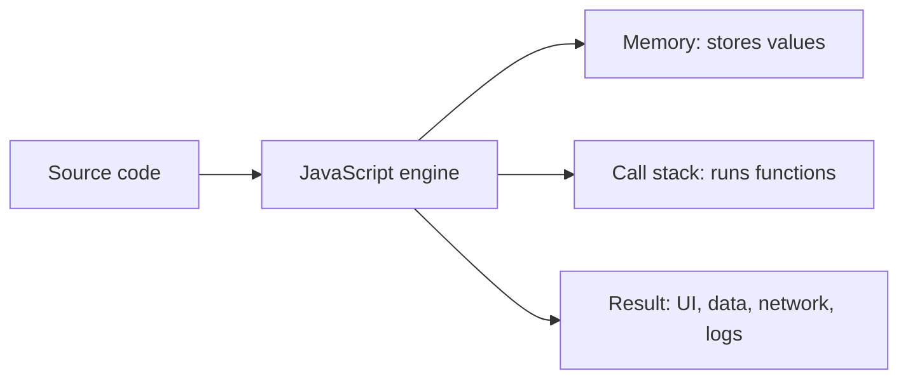
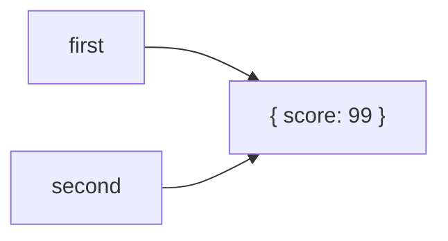
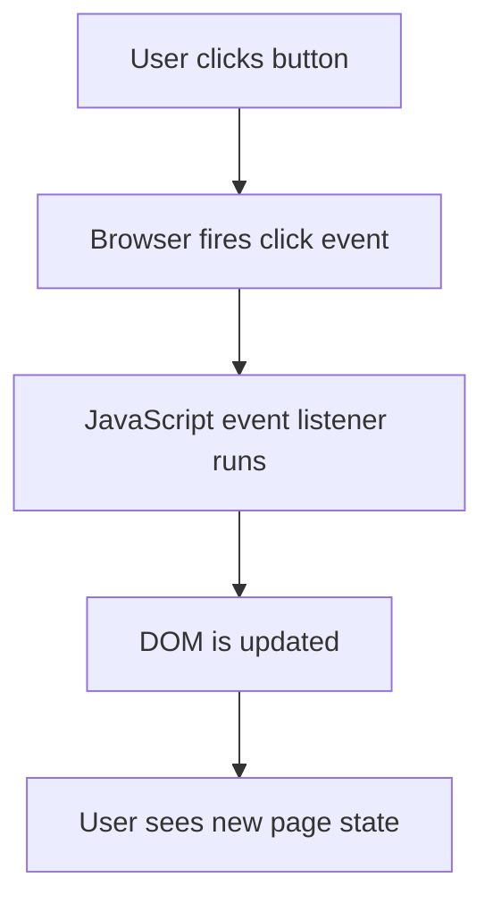

# 01. JavaScript Foundations

## 1. What JavaScript Is

JavaScript is a programming language used to make web pages interactive, build servers, write scripts, create apps, and control many tools.

HTML gives structure:

```html
<button>Buy</button>
```

CSS gives style:

```css
button {
  background: green;
  color: white;
}
```

JavaScript gives behavior:

```js
console.log("Button clicked");
```

### Mental Model

Think of a program as a list of instructions. JavaScript reads and runs those instructions from top to bottom unless you use control flow such as `if`, loops, function calls, or async behavior.



## 2. Running JavaScript

### In The Browser

```html
<!DOCTYPE html>
<html>
  <body>
    <script>
      console.log("Hello from the browser");
    </script>
  </body>
</html>
```

Line by line:

- `<!DOCTYPE html>` tells the browser this is modern HTML.
- `<script>` tells the browser to run JavaScript.
- `console.log(...)` prints a message in DevTools Console.

### In Node.js

Create `app.js`:

```js
console.log("Hello from Node");
```

Run:

```bash
node app.js
```

Node.js lets JavaScript run outside the browser.

## 3. Values And Types

A value is a piece of data.

Common primitive types:

```js
console.log(typeof "hello"); // string
console.log(typeof 42); // number
console.log(typeof true); // boolean
console.log(typeof undefined); // undefined
console.log(typeof null); // object, historical JavaScript mistake
console.log(typeof 10n); // bigint
console.log(typeof Symbol("id")); // symbol
```

Objects are compound values:

```js
const user = {
  name: "Asha",
  age: 21
};
```

### Important Idea: Primitive Vs Reference

Primitive values are copied by value:

```js
let a = 10;
let b = a;
b = 20;

console.log(a); // 10
console.log(b); // 20
```

Objects and arrays are copied by reference:

```js
const first = { score: 10 };
const second = first;

second.score = 99;

console.log(first.score); // 99
```

`first` and `second` point to the same object in memory.



## 4. Variables

Variables store values.

```js
let count = 0;
count = 1;

const name = "Ravi";

var oldStyle = "avoid in modern code";
```

Use:

- `const` by default.
- `let` when the variable must change.
- Avoid `var` in modern JavaScript.

### Naming Rules

Good names explain purpose:

```js
const totalPrice = 499;
const isLoggedIn = true;
const cartItems = [];
```

Avoid vague names:

```js
const x = 499;
const data = true;
```

## 5. Operators

Arithmetic:

```js
console.log(10 + 5); // 15
console.log(10 - 5); // 5
console.log(10 * 5); // 50
console.log(10 / 5); // 2
console.log(10 % 3); // 1
console.log(2 ** 3); // 8
```

Comparison:

```js
console.log(5 > 3); // true
console.log(5 === "5"); // false
console.log(5 !== "5"); // true
```

Prefer `===` and `!==` because they do not perform surprising type conversion.

Logical:

```js
const hasAccount = true;
const hasPaid = false;

console.log(hasAccount && hasPaid); // false
console.log(hasAccount || hasPaid); // true
console.log(!hasAccount); // false
```

## 6. Numbers And Math

JavaScript has one main number type for integers and decimals.

```js
const price = 19.99;
const quantity = 3;
const total = price * quantity;

console.log(total); // 59.97
```

Floating point numbers can be imprecise:

```js
console.log(0.1 + 0.2); // 0.30000000000000004
```

For money, store cents:

```js
const priceCents = 1999;
const quantity = 3;
const totalCents = priceCents * quantity;

console.log(totalCents); // 5997
console.log(totalCents / 100); // 59.97
```

Math helpers:

```js
console.log(Math.round(4.6)); // 5
console.log(Math.floor(4.9)); // 4
console.log(Math.ceil(4.1)); // 5
console.log(Math.max(3, 9, 2)); // 9
console.log(Math.min(3, 9, 2)); // 2
console.log(Math.random()); // random number from 0 to less than 1
```

Random integer from 1 to 6:

```js
const dice = Math.floor(Math.random() * 6) + 1;
console.log(dice);
```

Line by line:

- `Math.random()` gives a decimal from `0` up to but not including `1`.
- Multiplying by `6` gives `0` up to less than `6`.
- `Math.floor(...)` removes the decimal.
- `+ 1` changes the range from `0..5` to `1..6`.

## 7. Strings

Strings store text.

```js
const firstName = "Maya";
const lastName = "Sharma";
const fullName = firstName + " " + lastName;

console.log(fullName); // Maya Sharma
```

Template literals are easier:

```js
const age = 22;
const message = `${firstName} is ${age} years old.`;

console.log(message);
```

Useful string methods:

```js
const text = " JavaScript is powerful ";

console.log(text.trim()); // removes outside spaces
console.log(text.toUpperCase());
console.log(text.toLowerCase());
console.log(text.includes("Script")); // true
console.log(text.replace("powerful", "fun"));
console.log(text.slice(1, 11)); // JavaScript
```

Strings are immutable. Methods return new strings.

## 8. Booleans And If Statements

A boolean is `true` or `false`.

```js
const temperature = 32;

if (temperature > 30) {
  console.log("It is hot");
} else {
  console.log("It is not too hot");
}
```

Multiple conditions:

```js
const marks = 82;

if (marks >= 90) {
  console.log("A");
} else if (marks >= 75) {
  console.log("B");
} else if (marks >= 60) {
  console.log("C");
} else {
  console.log("Needs improvement");
}
```

### Truthy And Falsy

Falsy values:

- `false`
- `0`
- `""`
- `null`
- `undefined`
- `NaN`

Everything else is truthy.

```js
const name = "";

if (name) {
  console.log("Name exists");
} else {
  console.log("Name is empty");
}
```

## 9. Functions

Functions group reusable instructions.

```js
function greet(name) {
  return `Hello, ${name}`;
}

const message = greet("Asha");
console.log(message);
```

Line by line:

- `function greet(name)` creates a function named `greet`.
- `name` is a parameter.
- `return` sends a result back to the caller.
- `greet("Asha")` calls the function with an argument.

Function expression:

```js
const add = function (a, b) {
  return a + b;
};
```

Arrow function:

```js
const multiply = (a, b) => {
  return a * b;
};
```

Short arrow function:

```js
const square = number => number * number;
```

### Pure Functions

A pure function:

- Gives the same output for the same input.
- Does not change outside state.

```js
function calculateTax(price, taxRate) {
  return price * taxRate;
}
```

Pure functions are easier to test.

## 10. Arrays

Arrays store ordered lists.

```js
const fruits = ["apple", "banana", "mango"];

console.log(fruits[0]); // apple
console.log(fruits.length); // 3
```

Common methods:

```js
const numbers = [1, 2, 3];

numbers.push(4); // add at end
numbers.pop(); // remove from end
numbers.unshift(0); // add at start
numbers.shift(); // remove from start

console.log(numbers);
```

Looping:

```js
const names = ["Asha", "Ravi", "Meera"];

for (let i = 0; i < names.length; i++) {
  console.log(names[i]);
}
```

Modern array methods:

```js
const prices = [100, 200, 300];

const withTax = prices.map(price => price * 1.18);
const expensive = prices.filter(price => price >= 200);
const total = prices.reduce((sum, price) => sum + price, 0);

console.log(withTax);
console.log(expensive);
console.log(total);
```

Method meanings:

- `map` transforms every item and returns a new array.
- `filter` keeps only items that pass a condition.
- `reduce` turns an array into one final value.

## 11. Objects

Objects store related data as key-value pairs.

```js
const product = {
  name: "Laptop",
  price: 50000,
  inStock: true
};

console.log(product.name);
console.log(product["price"]);
```

Updating:

```js
product.price = 48000;
product.rating = 4.5;

delete product.inStock;
```

Methods:

```js
const cart = {
  items: [],
  addItem(product) {
    this.items.push(product);
  }
};

cart.addItem("Keyboard");
console.log(cart.items);
```

`this` means the object before the dot in many normal method calls.

## 12. Destructuring, Spread, And Rest

Destructuring pulls values out.

```js
const user = {
  id: 1,
  username: "coder",
  email: "coder@example.com"
};

const { username, email } = user;
console.log(username, email);
```

Array destructuring:

```js
const colors = ["red", "green", "blue"];
const [firstColor, secondColor] = colors;
```

Spread copies values:

```js
const oldCart = ["Book"];
const newCart = [...oldCart, "Pen"];

const oldUser = { name: "Asha", age: 20 };
const updatedUser = { ...oldUser, age: 21 };
```

Rest collects values:

```js
function sum(...numbers) {
  return numbers.reduce((total, number) => total + number, 0);
}

console.log(sum(1, 2, 3, 4));
```

## 13. Loops

`for` loop:

```js
for (let i = 1; i <= 5; i++) {
  console.log(i);
}
```

`while` loop:

```js
let count = 1;

while (count <= 5) {
  console.log(count);
  count++;
}
```

`for...of` loop:

```js
const tasks = ["study", "code", "review"];

for (const task of tasks) {
  console.log(task);
}
```

Use array methods when transforming arrays. Use loops when you need more custom control.

## 14. DOM Basics

The DOM is the browser's object version of your HTML.

```html
<button id="save-button">Save</button>
<p id="message"></p>

<script>
  const button = document.querySelector("#save-button");
  const message = document.querySelector("#message");

  button.addEventListener("click", () => {
    message.textContent = "Saved!";
  });
</script>
```

Line by line:

- `document.querySelector(...)` finds an HTML element.
- `button.addEventListener("click", ...)` waits for a click.
- The arrow function runs when the click happens.
- `message.textContent = "Saved!"` changes what the page shows.



## 15. Mini Project: Counter

```html
<!DOCTYPE html>
<html>
  <body>
    <button id="decrease">-</button>
    <span id="count">0</span>
    <button id="increase">+</button>

    <script>
      let count = 0;

      const countElement = document.querySelector("#count");
      const increaseButton = document.querySelector("#increase");
      const decreaseButton = document.querySelector("#decrease");

      function render() {
        countElement.textContent = count;
      }

      increaseButton.addEventListener("click", () => {
        count++;
        render();
      });

      decreaseButton.addEventListener("click", () => {
        count--;
        render();
      });
    </script>
  </body>
</html>
```

Important lesson: state is the data that changes over time. Here, `count` is state. `render` updates the screen from the state.

