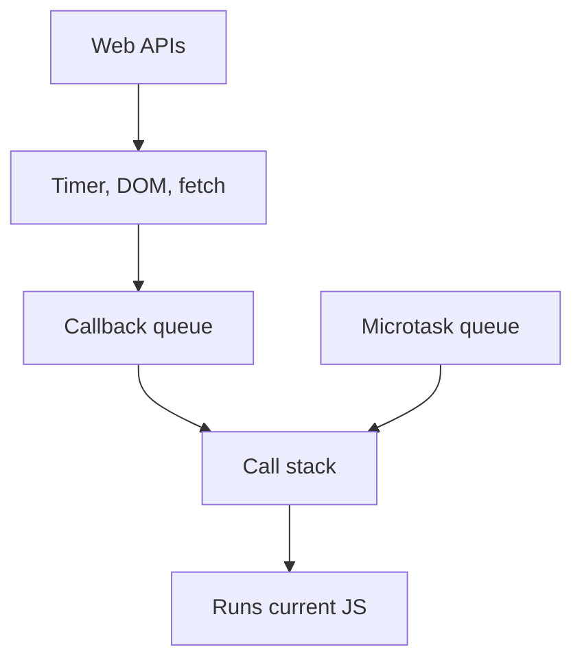
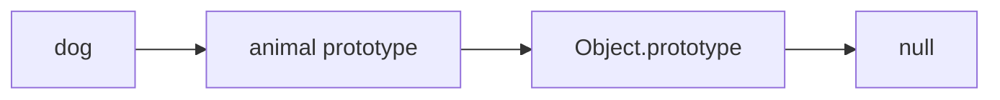

# 02. Advanced JavaScript

## 1. Execution Model

JavaScript runs using:

- Memory: stores variables and functions.
- Call stack: tracks which function is currently running.
- Web APIs or Node APIs: handle timers, network, file system, and other outside work.
- Task queues: schedule callbacks.



Microtasks from promises usually run before normal timer callbacks.

## 2. Scope

Scope controls where variables can be used.

```js
const globalName = "Global";

function showName() {
  const localName = "Local";
  console.log(globalName);
  console.log(localName);
}

showName();
console.log(globalName);
// console.log(localName); // Error
```

Block scope:

```js
if (true) {
  let message = "inside";
  const status = "active";
}

// message and status cannot be used here
```

`let` and `const` are block-scoped. `var` is function-scoped and can cause confusion.

## 3. Hoisting

JavaScript prepares declarations before running code.

Function declarations are hoisted:

```js
sayHello();

function sayHello() {
  console.log("Hello");
}
```

`let` and `const` are hoisted but cannot be used before declaration:

```js
// console.log(name); // Error
const name = "Asha";
```

## 4. Closures

A closure happens when a function remembers variables from the place where it was created.

```js
function createCounter() {
  let count = 0;

  return function increment() {
    count++;
    return count;
  };
}

const counter = createCounter();

console.log(counter()); // 1
console.log(counter()); // 2
console.log(counter()); // 3
```

Line by line:

- `createCounter` creates a local variable `count`.
- It returns the inner function `increment`.
- Even after `createCounter` finishes, `increment` remembers `count`.
- This remembered environment is called a closure.

Closures are useful for private state, event handlers, and function factories.

## 5. `this`

`this` depends on how a function is called.

```js
const user = {
  name: "Asha",
  sayName() {
    console.log(this.name);
  }
};

user.sayName(); // Asha
```

Here, `this` is `user` because the call is `user.sayName()`.

Arrow functions do not create their own `this`.

```js
const team = {
  name: "Frontend",
  members: ["Asha", "Ravi"],
  printMembers() {
    this.members.forEach(member => {
      console.log(`${member} belongs to ${this.name}`);
    });
  }
};
```

The arrow function uses `this` from `printMembers`.

## 6. Prototypes

Objects can inherit behavior from other objects.

```js
const animal = {
  eat() {
    console.log("Eating");
  }
};

const dog = Object.create(animal);
dog.name = "Bruno";

dog.eat(); // Eating
```

`dog` does not own `eat`, but it finds it through its prototype chain.



## 7. Classes

Classes are cleaner syntax for constructor functions and prototypes.

```js
class Product {
  constructor(name, priceCents) {
    this.name = name;
    this.priceCents = priceCents;
  }

  getPrice() {
    return this.priceCents / 100;
  }
}

const laptop = new Product("Laptop", 5000000);
console.log(laptop.getPrice());
```

Line by line:

- `class Product` defines a blueprint.
- `constructor` runs when using `new Product(...)`.
- `this.name` creates a property on the new object.
- `getPrice` is shared through the prototype.

Inheritance:

```js
class DigitalProduct extends Product {
  constructor(name, priceCents, downloadUrl) {
    super(name, priceCents);
    this.downloadUrl = downloadUrl;
  }

  download() {
    console.log(`Downloading from ${this.downloadUrl}`);
  }
}
```

Use inheritance carefully. Composition is often simpler.

## 8. Composition

Composition means building behavior by combining small pieces.

```js
function canLog(entity) {
  return {
    log() {
      console.log(entity.name);
    }
  };
}

function createUser(name) {
  const user = { name };
  return {
    ...user,
    ...canLog(user)
  };
}

const user = createUser("Meera");
user.log();
```

Composition is useful when inheritance becomes too rigid.

## 9. Error Handling

Errors stop normal code flow unless handled.

```js
try {
  const data = JSON.parse("{ bad json }");
  console.log(data);
} catch (error) {
  console.log("Could not parse JSON");
  console.log(error.message);
}
```

Throw your own errors:

```js
function divide(a, b) {
  if (b === 0) {
    throw new Error("Cannot divide by zero");
  }

  return a / b;
}
```

Use errors for truly invalid situations, not normal choices.

## 10. Modules

Modules split code into files.

`math.js`:

```js
export function add(a, b) {
  return a + b;
}

export const PI = 3.14159;
```

`app.js`:

```js
import { add, PI } from "./math.js";

console.log(add(2, 3));
console.log(PI);
```

Default export:

```js
export default function greet(name) {
  return `Hello, ${name}`;
}
```

```js
import greet from "./greet.js";
```

Named exports are often clearer because import names stay consistent.

## 11. JSON

JSON is a data format based on JavaScript object syntax.

```js
const user = {
  name: "Asha",
  age: 21
};

const json = JSON.stringify(user);
console.log(json);

const parsed = JSON.parse(json);
console.log(parsed.name);
```

JSON rules:

- Keys must use double quotes.
- No functions.
- No comments.
- Data only.

## 12. Async JavaScript

Some work takes time: network requests, timers, file reads.

### Callback

```js
setTimeout(() => {
  console.log("Runs later");
}, 1000);
```

### Promise

```js
const promise = new Promise((resolve, reject) => {
  const success = true;

  if (success) {
    resolve("Done");
  } else {
    reject(new Error("Failed"));
  }
});

promise
  .then(result => {
    console.log(result);
  })
  .catch(error => {
    console.log(error.message);
  });
```

Promise states:

- Pending: still working.
- Fulfilled: finished successfully.
- Rejected: failed.

### Async/Await

```js
async function loadUser() {
  try {
    const response = await fetch("https://jsonplaceholder.typicode.com/users/1");
    const user = await response.json();
    console.log(user.name);
  } catch (error) {
    console.log("Failed to load user");
  }
}

loadUser();
```

Line by line:

- `async` allows `await` inside the function.
- `fetch(...)` starts a network request.
- `await` pauses this function until the promise settles.
- `response.json()` reads and parses the response body.
- `try/catch` handles failures.

## 13. Promise Helpers

Run requests in parallel:

```js
const [user, posts] = await Promise.all([
  fetch("/api/user").then(response => response.json()),
  fetch("/api/posts").then(response => response.json())
]);
```

Use:

- `Promise.all` when all must succeed.
- `Promise.allSettled` when you want every result, even failures.
- `Promise.race` when the first settled result wins.
- `Promise.any` when the first successful result wins.

## 14. Iterators And Generators

Iterables can be looped with `for...of`.

```js
const letters = ["a", "b", "c"];

for (const letter of letters) {
  console.log(letter);
}
```

Generator functions can pause and resume:

```js
function* idGenerator() {
  let id = 1;

  while (true) {
    yield id;
    id++;
  }
}

const ids = idGenerator();
console.log(ids.next().value); // 1
console.log(ids.next().value); // 2
```

Generators are useful for custom iteration, streams, and advanced control flow.

## 15. Maps, Sets, WeakMaps, WeakSets

`Map` stores key-value pairs where keys can be any value.

```js
const scores = new Map();
scores.set("Asha", 90);
scores.set("Ravi", 82);

console.log(scores.get("Asha"));
console.log(scores.has("Ravi"));
```

`Set` stores unique values.

```js
const tags = new Set(["js", "react", "js"]);
console.log(tags); // Set with js and react
```

Remove duplicates:

```js
const uniqueNumbers = [...new Set([1, 2, 2, 3])];
```

`WeakMap` and `WeakSet` hold weak references to objects. They are useful for advanced memory-sensitive patterns.

## 16. Immutability

Immutability means creating new data instead of changing existing data.

```js
const todo = { id: 1, text: "Study", done: false };
const updatedTodo = { ...todo, done: true };
```

Array update:

```js
const todos = [
  { id: 1, text: "Study", done: false },
  { id: 2, text: "Code", done: false }
];

const updatedTodos = todos.map(todo =>
  todo.id === 1 ? { ...todo, done: true } : todo
);
```

React depends heavily on immutable updates because it compares old and new values.

## 17. Testing JavaScript

A test checks that code behaves correctly.

Function:

```js
export function formatPrice(cents) {
  return `Rs ${(cents / 100).toFixed(2)}`;
}
```

Test:

```js
import { describe, expect, it } from "vitest";
import { formatPrice } from "./formatPrice.js";

describe("formatPrice", () => {
  it("formats cents as rupees", () => {
    expect(formatPrice(1299)).toBe("Rs 12.99");
  });
});
```

Types of tests:

- Unit tests: small function or component.
- Integration tests: multiple pieces working together.
- End-to-end tests: full app in browser.

## 18. TypeScript Overview

TypeScript adds types to JavaScript.

```ts
function add(a: number, b: number): number {
  return a + b;
}

add(2, 3);
// add("2", "3"); // Type error
```

Object type:

```ts
type User = {
  id: number;
  name: string;
  email?: string;
};

function printUser(user: User) {
  console.log(user.name);
}
```

TypeScript helps catch mistakes before running the app.
