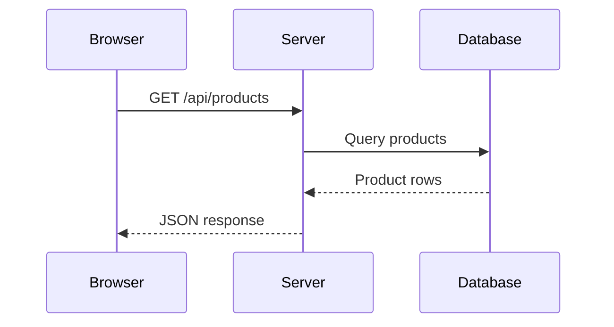

# 03. Browser And Backend JavaScript

## 1. Browser JavaScript

The browser gives JavaScript extra APIs:

- `document` for the page.
- `window` for the browser tab.
- `localStorage` for simple persistent storage.
- `fetch` for network requests.
- `navigator` for browser/device information.
- Events for clicks, input, keyboard, scroll, and more.

JavaScript itself does not know what a button is. The browser provides the DOM API that lets JavaScript work with HTML.

## 2. DOM Selection And Updates

HTML:

```html
<h1 id="title">Shopping Cart</h1>
<button class="js-add">Add</button>
```

JavaScript:

```js
const title = document.querySelector("#title");
const addButton = document.querySelector(".js-add");

title.textContent = "Your Cart";
addButton.disabled = false;
```

Common DOM properties:

- `textContent`: changes text safely.
- `innerHTML`: inserts HTML, use carefully.
- `value`: reads or writes form input values.
- `classList`: adds, removes, toggles classes.
- `dataset`: reads `data-*` attributes.

Example:

```html
<button data-product-id="p1" class="js-buy-button">Buy</button>
```

```js
const button = document.querySelector(".js-buy-button");
console.log(button.dataset.productId); // p1
```

## 3. Events

Events are messages from the browser that something happened.

```js
const input = document.querySelector("#search");

input.addEventListener("input", event => {
  console.log(event.target.value);
});
```

Line by line:

- `input` event fires whenever the field changes.
- `event` contains details about the event.
- `event.target` is the element that fired the event.
- `event.target.value` is the current input text.

Common events:

- `click`
- `input`
- `change`
- `submit`
- `keydown`
- `keyup`
- `scroll`
- `mouseover`
- `focus`
- `blur`

## 4. Forms

HTML:

```html
<form id="signup-form">
  <input id="email" type="email" />
  <button type="submit">Sign up</button>
</form>
```

JavaScript:

```js
const form = document.querySelector("#signup-form");
const emailInput = document.querySelector("#email");

form.addEventListener("submit", event => {
  event.preventDefault();

  const email = emailInput.value.trim();

  if (!email) {
    console.log("Email is required");
    return;
  }

  console.log(`Submitting ${email}`);
});
```

`event.preventDefault()` stops the browser from refreshing the page.

## 5. Event Delegation

Instead of adding an event listener to every button, add one listener to the parent.

```html
<div id="todo-list">
  <button data-id="1">Delete</button>
  <button data-id="2">Delete</button>
</div>
```

```js
const list = document.querySelector("#todo-list");

list.addEventListener("click", event => {
  const button = event.target.closest("button");

  if (!button) {
    return;
  }

  console.log(`Delete todo ${button.dataset.id}`);
});
```

This works even if new buttons are added later.

## 6. Local Storage

`localStorage` stores strings in the browser.

```js
const settings = {
  theme: "dark",
  fontSize: 16
};

localStorage.setItem("settings", JSON.stringify(settings));

const saved = JSON.parse(localStorage.getItem("settings"));
console.log(saved.theme);
```

Use local storage for small non-sensitive data. Do not store passwords or secrets.

## 7. Fetch And HTTP

HTTP is how browsers talk to servers.

Common methods:

- `GET`: read data.
- `POST`: create data.
- `PUT`: replace data.
- `PATCH`: update part of data.
- `DELETE`: remove data.

Fetch example:

```js
async function loadProducts() {
  const response = await fetch("/api/products");

  if (!response.ok) {
    throw new Error("Failed to load products");
  }

  const products = await response.json();
  return products;
}
```

POST example:

```js
async function createProduct(product) {
  const response = await fetch("/api/products", {
    method: "POST",
    headers: {
      "Content-Type": "application/json"
    },
    body: JSON.stringify(product)
  });

  if (!response.ok) {
    throw new Error("Failed to create product");
  }

  return response.json();
}
```

## 8. Rendering Lists With Plain JavaScript

```html
<ul id="products"></ul>
```

```js
const products = [
  { id: 1, name: "Keyboard", price: 1500 },
  { id: 2, name: "Mouse", price: 800 }
];

const list = document.querySelector("#products");

list.innerHTML = products
  .map(product => {
    return `
      <li>
        ${product.name} - Rs ${product.price}
      </li>
    `;
  })
  .join("");
```

For user-provided text, prefer creating elements and setting `textContent` to avoid unsafe HTML injection.

## 9. Security Basics

Important browser security concepts:

- XSS: attacker injects JavaScript into your page.
- CSRF: attacker tricks a logged-in user into submitting a request.
- CORS: browser rule controlling cross-origin requests.
- HTTPS: encrypts network traffic.
- Authentication: proves who a user is.
- Authorization: decides what a user can access.

Avoid:

```js
output.innerHTML = userInput;
```

Prefer:

```js
output.textContent = userInput;
```

## 10. Backend With Node.js

Node.js runs JavaScript on a server.

Basic server with Express:

```js
import express from "express";

const app = express();

app.use(express.json());

app.get("/api/health", (request, response) => {
  response.json({ status: "ok" });
});

app.listen(3000, () => {
  console.log("Server running on http://localhost:3000");
});
```

Line by line:

- `express` creates a server app.
- `app.use(express.json())` lets the server read JSON request bodies.
- `app.get(...)` handles GET requests.
- `request` contains incoming request information.
- `response` sends data back to the client.
- `app.listen(3000, ...)` starts the server.

## 11. REST API Example

```js
const todos = [
  { id: 1, text: "Learn JS", done: false }
];

app.get("/api/todos", (request, response) => {
  response.json(todos);
});

app.post("/api/todos", (request, response) => {
  const todo = {
    id: Date.now(),
    text: request.body.text,
    done: false
  };

  todos.push(todo);
  response.status(201).json(todo);
});
```

This stores data in memory. Real apps use databases.

## 12. Backend Request Lifecycle



## 13. Debugging Checklist

When code does not work:

1. Read the error message carefully.
2. Check the file and line number.
3. Use `console.log` to inspect values.
4. Check spelling and case.
5. Check if values are `undefined` or `null`.
6. Check network requests in DevTools.
7. Make the problem smaller.
8. Rebuild one piece at a time.

## 14. Mini Project: Todo App With Local Storage

```html
<form id="todo-form">
  <input id="todo-input" />
  <button>Add</button>
</form>
<ul id="todo-list"></ul>

<script>
  const form = document.querySelector("#todo-form");
  const input = document.querySelector("#todo-input");
  const list = document.querySelector("#todo-list");

  let todos = JSON.parse(localStorage.getItem("todos")) || [];

  function saveTodos() {
    localStorage.setItem("todos", JSON.stringify(todos));
  }

  function renderTodos() {
    list.innerHTML = "";

    todos.forEach(todo => {
      const item = document.createElement("li");
      item.textContent = todo.text;
      list.appendChild(item);
    });
  }

  form.addEventListener("submit", event => {
    event.preventDefault();

    const text = input.value.trim();

    if (!text) {
      return;
    }

    todos.push({ id: Date.now(), text });
    input.value = "";

    saveTodos();
    renderTodos();
  });

  renderTodos();
</script>
```

Key idea: data lives in `todos`, the browser display comes from `renderTodos`, and persistence comes from `localStorage`.

