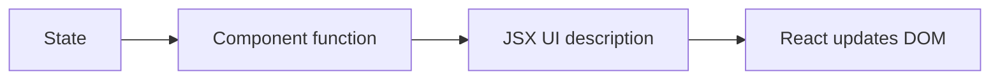

# 04. React Foundations

## 1. What React Is

React is a JavaScript library for building user interfaces. It helps you break the UI into components.

Instead of manually changing the DOM again and again, you describe what the UI should look like for the current data. React updates the browser.



## 2. React Mental Model

Core idea:

```txt
UI = function(state)
```

If state changes, React calls your component again and calculates the next UI.

Plain JavaScript counter:

```js
count++;
countElement.textContent = count;
```

React counter:

```jsx
setCount(count + 1);
```

React handles the DOM update.

## 3. Vite Setup

Create app:

```bash
npm create vite@latest my-app -- --template react
cd my-app
npm install
npm run dev
```

Typical structure:

```txt
my-app/
  index.html
  package.json
  src/
    main.jsx
    App.jsx
    App.css
```

`main.jsx`:

```jsx
import { StrictMode } from "react";
import { createRoot } from "react-dom/client";
import "./App.css";
import App from "./App.jsx";

createRoot(document.getElementById("root")).render(
  <StrictMode>
    <App />
  </StrictMode>
);
```

Line by line:

- `createRoot` connects React to the real HTML element.
- `document.getElementById("root")` finds the app container.
- `<App />` renders your main component.
- `StrictMode` helps find problems during development.

## 4. JSX

JSX lets you write HTML-like syntax inside JavaScript.

```jsx
function App() {
  const name = "Asha";

  return <h1>Hello, {name}</h1>;
}
```

Rules:

- Return one parent element.
- Use `className` instead of `class`.
- Use `{}` to put JavaScript expressions inside JSX.
- Close every tag.
- Use camelCase for many DOM props, like `onClick`.

Fragment:

```jsx
function App() {
  return (
    <>
      <h1>Title</h1>
      <p>Description</p>
    </>
  );
}
```

## 5. Components

A component is a reusable UI function.

```jsx
function ProductCard() {
  return (
    <article>
      <h2>Keyboard</h2>
      <p>Rs 1500</p>
      <button>Add to cart</button>
    </article>
  );
}

export default ProductCard;
```

Use it:

```jsx
import ProductCard from "./ProductCard.jsx";

function App() {
  return <ProductCard />;
}
```

Component names must start with a capital letter.

## 6. Props

Props pass data from parent to child.

```jsx
function ProductCard({ name, price }) {
  return (
    <article>
      <h2>{name}</h2>
      <p>Rs {price}</p>
    </article>
  );
}

function App() {
  return <ProductCard name="Mouse" price={800} />;
}
```

Line by line:

- `ProductCard({ name, price })` receives props.
- `{name}` displays the value.
- `price={800}` passes a number.
- `name="Mouse"` passes a string.

Props should be treated as read-only.

## 7. Rendering Lists

```jsx
const products = [
  { id: 1, name: "Keyboard", price: 1500 },
  { id: 2, name: "Mouse", price: 800 }
];

function App() {
  return (
    <main>
      {products.map(product => (
        <ProductCard
          key={product.id}
          name={product.name}
          price={product.price}
        />
      ))}
    </main>
  );
}
```

`key` helps React track list items. Use stable IDs, not array index, when possible.

## 8. Conditional Rendering

```jsx
function Greeting({ isLoggedIn }) {
  if (isLoggedIn) {
    return <p>Welcome back</p>;
  }

  return <p>Please log in</p>;
}
```

Using `&&`:

```jsx
function CartMessage({ cartCount }) {
  return (
    <p>
      Cart
      {cartCount > 0 && <span> ({cartCount})</span>}
    </p>
  );
}
```

Using ternary:

```jsx
function SaveButton({ isSaving }) {
  return <button>{isSaving ? "Saving..." : "Save"}</button>;
}
```

## 9. State

State is data that changes and affects the UI.

```jsx
import { useState } from "react";

function Counter() {
  const [count, setCount] = useState(0);

  return (
    <div>
      <p>{count}</p>
      <button onClick={() => setCount(count + 1)}>Increase</button>
    </div>
  );
}
```

Line by line:

- `useState(0)` creates state with initial value `0`.
- `count` is the current value.
- `setCount` updates the value.
- When `setCount` runs, React renders the component again.

Functional update:

```jsx
setCount(currentCount => currentCount + 1);
```

Use this when the next state depends on the previous state.

## 10. Events

```jsx
function SearchBox() {
  const [query, setQuery] = useState("");

  function handleChange(event) {
    setQuery(event.target.value);
  }

  return (
    <label>
      Search
      <input value={query} onChange={handleChange} />
    </label>
  );
}
```

React event names use camelCase:

- `onClick`
- `onChange`
- `onSubmit`
- `onKeyDown`

## 11. Controlled Forms

React controls the input value through state.

```jsx
function SignupForm() {
  const [email, setEmail] = useState("");

  function handleSubmit(event) {
    event.preventDefault();
    console.log(email);
  }

  return (
    <form onSubmit={handleSubmit}>
      <input
        type="email"
        value={email}
        onChange={event => setEmail(event.target.value)}
      />
      <button>Sign up</button>
    </form>
  );
}
```

The input displays `email`. When the user types, `onChange` updates `email`.

## 12. Updating Arrays In State

```jsx
function TodoApp() {
  const [todos, setTodos] = useState([]);
  const [text, setText] = useState("");

  function addTodo(event) {
    event.preventDefault();

    if (!text.trim()) {
      return;
    }

    setTodos([
      ...todos,
      { id: Date.now(), text: text.trim(), done: false }
    ]);
    setText("");
  }

  return (
    <form onSubmit={addTodo}>
      <input value={text} onChange={event => setText(event.target.value)} />
      <button>Add</button>

      <ul>
        {todos.map(todo => (
          <li key={todo.id}>{todo.text}</li>
        ))}
      </ul>
    </form>
  );
}
```

Do not mutate state:

```jsx
// Avoid
todos.push(newTodo);
setTodos(todos);
```

Create a new array:

```jsx
setTodos([...todos, newTodo]);
```

## 13. Updating Objects In State

```jsx
const [user, setUser] = useState({
  name: "Asha",
  age: 21
});

setUser({
  ...user,
  age: 22
});
```

Nested update:

```jsx
setUser({
  ...user,
  address: {
    ...user.address,
    city: "Bengaluru"
  }
});
```

## 14. useEffect

`useEffect` runs after React updates the screen.

```jsx
import { useEffect, useState } from "react";

function Clock() {
  const [time, setTime] = useState(new Date());

  useEffect(() => {
    const id = setInterval(() => {
      setTime(new Date());
    }, 1000);

    return () => {
      clearInterval(id);
    };
  }, []);

  return <p>{time.toLocaleTimeString()}</p>;
}
```

Line by line:

- The effect creates an interval.
- The interval updates time every second.
- The cleanup function clears the interval.
- `[]` means run this effect once after mount.

Common effect uses:

- Synchronize with external systems.
- Fetch data.
- Subscribe and unsubscribe.
- Timers.

Do not use effects for simple calculations that can happen during render.

## 15. Custom Hooks

A custom hook extracts reusable stateful logic.

```jsx
import { useEffect, useState } from "react";

function useLocalStorage(key, initialValue) {
  const [value, setValue] = useState(() => {
    const saved = localStorage.getItem(key);
    return saved ? JSON.parse(saved) : initialValue;
  });

  useEffect(() => {
    localStorage.setItem(key, JSON.stringify(value));
  }, [key, value]);

  return [value, setValue];
}
```

Use it:

```jsx
function App() {
  const [theme, setTheme] = useLocalStorage("theme", "light");

  return (
    <button onClick={() => setTheme(theme === "light" ? "dark" : "light")}>
      {theme}
    </button>
  );
}
```

Custom hooks must start with `use`.

## 16. CSS In React

Simple CSS file:

```jsx
import "./Button.css";

function Button({ children }) {
  return <button className="button">{children}</button>;
}
```

CSS:

```css
.button {
  border: 0;
  border-radius: 6px;
  padding: 8px 12px;
}
```

Conditional class:

```jsx
function Alert({ type, children }) {
  return <div className={`alert alert-${type}`}>{children}</div>;
}
```

Inline styles use objects:

```jsx
<div style={{ color: "red", fontSize: 16 }}>Error</div>
```

Use inline styles for dynamic values, not large style systems.

